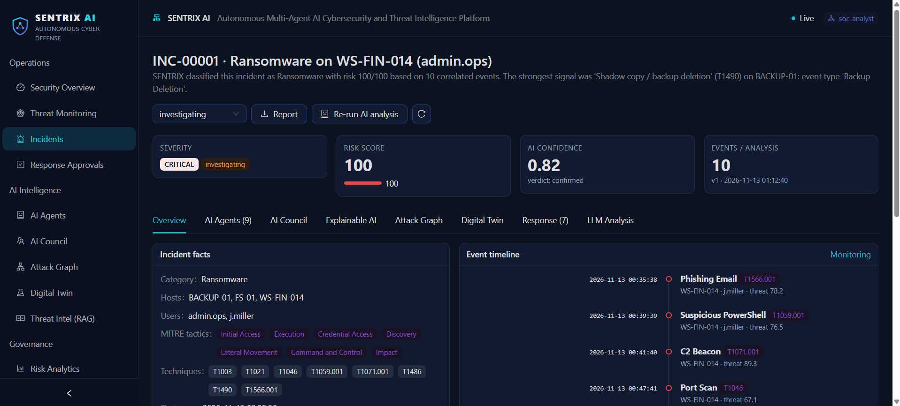
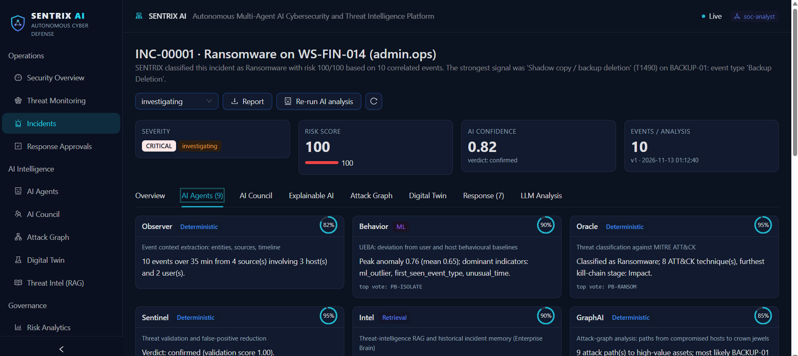
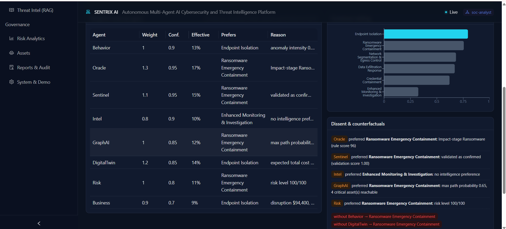
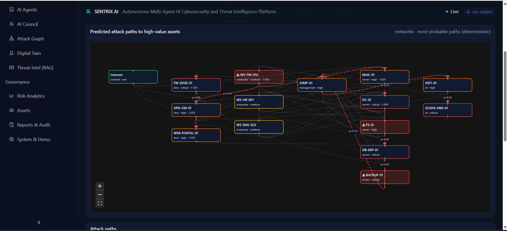
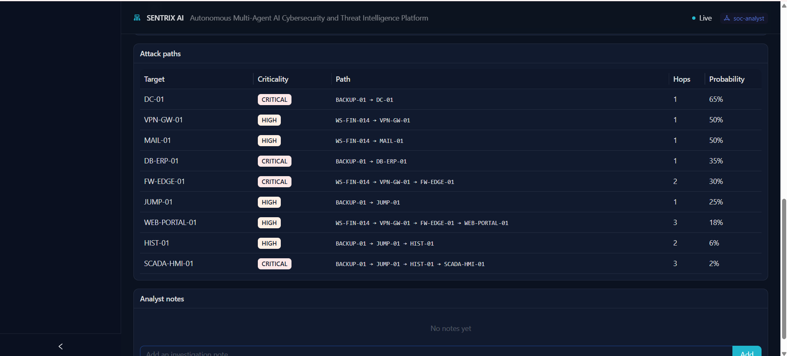
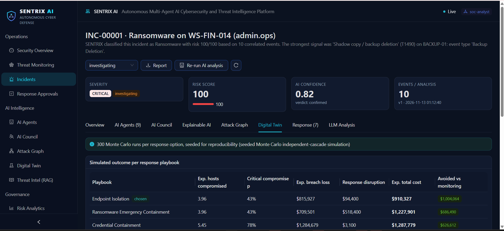
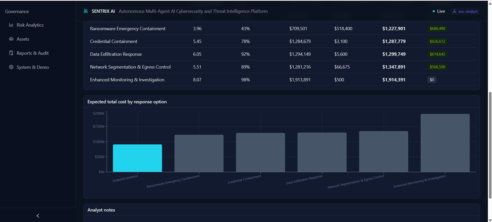
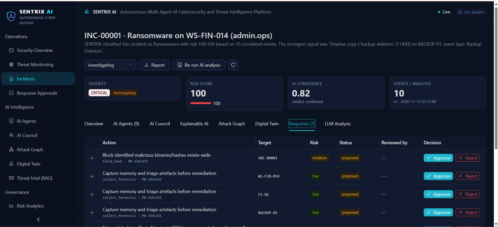

# 🛡️ SENTRIX AI

**Autonomous Multi-Agent AI Cybersecurity and Threat Intelligence Platform**

SENTRIX AI ingests security telemetry, detects behavioural anomalies, classifies
threats against MITRE ATT&CK, correlates events into incidents, and runs a
multi-agent AI analysis that produces an explainable, human-approved response
recommendation. It is a demonstrable SOC-assistant platform you can run locally.

> SENTRIX AI is a **decision-support** system. It never executes containment
> automatically — every response action requires analyst approval. It assists a
> SOC; it does not replace one.

---

## What is real, and how

SENTRIX AI is deliberate about separating three kinds of intelligence. Every
agent and API labels which one it used.

| Kind | Meaning | Where |
|---|---|---|
| **Deterministic** | Rule-based / graph algorithms. Same input → same output. | Normalization, MITRE classification, correlation, attack graph, risk scoring, council consensus, explainable AI |
| **Machine learning** | Unsupervised models trained on your own data. | Behavioural anomaly detection (per-entity statistical baselines + scikit-learn Isolation Forest), TF-IDF retrieval for RAG |
| **Simulation** | Seeded Monte Carlo. Reproducible. | Cyber Digital Twin attack-spread model |
| **LLM (optional)** | Narrative generation only. Off by default. | Incident narrative, grounded RAG synthesis. **Never** influences scores, votes or actions. |

There are **no hidden random numbers** in the analysis path, no fabricated
metrics, and no "AI" that is secretly a hardcoded string. When a capability
needs an external credential (an LLM, a SOAR webhook), it is **off by default**,
clearly reported as disabled, and the platform degrades gracefully without it.

---

## Features (all implemented)

1. **Security event ingestion** — a normalization layer that accepts Windows
   Security / Sysmon event JSON, Linux syslog, firewall logs, and EDR/cloud
   alerts, plus a generic normalized schema. De-duplicates re-sent events.
2. **Behavioral anomaly detection (UEBA)** — per-user and per-host baselines
   (time-of-day, known processes/destinations/logon sources, event-rate) plus an
   Isolation Forest, fused into an explainable anomaly score.
3. **Threat classification** — ~40 detection rules mapped to MITRE ATT&CK
   techniques and tactics.
4. **Threat correlation** — time-window correlation of events (across linked
   hosts and users) into incidents, with back-fill of the full attack narrative.
5. **Multi-agent AI architecture** — nine specialist agents (Observer, Behavior,
   Oracle, Sentinel, Intel, Graph AI, Digital Twin, Risk, Business).
6. **AI Council with weighted consensus** — a confidence-weighted linear opinion
   pool over candidate response playbooks, with dissent and leave-one-out
   ablation.
7. **Threat Intelligence RAG** — TF-IDF retrieval over a curated MITRE ATT&CK /
   CISA KEV / playbook knowledge base, with optional grounded LLM synthesis.
8. **Attack graph analysis** — a networkx graph of the asset inventory;
   most-probable attack paths via Dijkstra over `-ln(p)` edge costs.
9. **Cyber Digital Twin simulation** — seeded Monte Carlo independent-cascade
   model estimating attack spread and business cost under each response option.
10. **Enterprise risk assessment** — per-asset and enterprise risk from threat,
    exposure (KEV matches), behaviour and criticality.
11. **Explainable AI** — detection evidence, factor attribution, agent
    contribution to the decision margin, and counterfactuals.
12. **Intelligent incident response recommendations** — a council decision
    translated into concrete, human-approved response actions.
13. **Enterprise security dashboard** — a React dashboard across every module.
14. **Historical incident management** — incident lifecycle, notes, assignment,
    and a searchable history that the Intel agent (Enterprise Brain) learns from.
15. **Audit logging** — an immutable record of every state-changing action,
    exportable to CSV.

---

## Architecture (at a glance)

```
 Telemetry (Windows/Sysmon/syslog/firewall/EDR/cloud)
        │  POST /api/events[/batch|/upload]
        ▼
 Normalizer ─► UEBA anomaly (baselines + Isolation Forest)
        │            │
        │      Oracle classifier (MITRE ATT&CK rules)
        ▼            ▼
 Threat score ─► Correlation ─► Incident
                                   │  (auto-analysis)
                                   ▼
   ┌─────────── Commander orchestrates the agent pipeline ───────────┐
   │ Observer · Behavior · Oracle · Sentinel · Intel(RAG+Brain)      │
   │ GraphAI(networkx) · DigitalTwin(Monte Carlo) · Risk · Business  │
   └─────────────────────────────┬──────────────────────────────────┘
                                  ▼
                 AI Council (weighted consensus)
                                  ▼
             Explainable AI  +  Narrator (optional LLM)
                                  ▼
          Proposed response actions ─► human approval ─► SOAR / manual
```

Full detail in [`docs/ARCHITECTURE.md`](docs/ARCHITECTURE.md).

---

## Quick start

Prerequisites: **Python 3.11+** and **Node.js 20+**. No external services are
required; the defaults use a local SQLite database and no API keys.

### 1. Backend

```bash
cd backend
python -m venv .venv
# Windows:  .venv\Scripts\activate
source .venv/bin/activate
pip install -r requirements.txt
cp .env.example .env            # optional — defaults are safe
uvicorn sentrix.main:app --reload --port 8000
```

Backend: <http://127.0.0.1:8000> · interactive API docs: <http://127.0.0.1:8000/docs>

### 2. Frontend (new terminal)

```bash
cd frontend
npm install
npm run dev
```

Dashboard: <http://127.0.0.1:5173> (the dev server proxies `/api` and `/ws` to the backend).

### 3. Load the demo

Open the dashboard → **System & Demo**, then:

1. **Load assets & baseline telemetry** (fictional "Meridian Energy", 7 days of baseline).
2. Pick a scenario (e.g. *Phishing → ransomware*) and **Run**.

Incidents appear with full AI analysis. Or from the CLI:

```bash
curl -X POST http://127.0.0.1:8000/api/demo/setup
curl -X POST http://127.0.0.1:8000/api/demo/run -H "Content-Type: application/json" -d '{"scenario":"ransomware"}'
```

**One-command start:** `./scripts/run_dev.sh` (starts backend + frontend; see [`docs/SETUP.md`](docs/SETUP.md)).

---

## Enabling the optional LLM

Everything works without an LLM. To enable narrative analysis and RAG synthesis,
set in `backend/.env`:

```bash
LLM_PROVIDER=anthropic           # or openai
ANTHROPIC_API_KEY=sk-ant-...      # or OPENAI_API_KEY=...
```

Keys are read from the environment only and are never logged or returned by any
API. With no key, the LLM status is reported as `disabled` and deterministic
output is used.

---

## Documentation

- [`docs/SETUP.md`](docs/SETUP.md) — detailed setup, database, exact run commands
- [`docs/ARCHITECTURE.md`](docs/ARCHITECTURE.md) — module-by-module design
- [`docs/API.md`](docs/API.md) — REST API reference
- [`docs/FEATURES.md`](docs/FEATURES.md) — feature → implementation map
- [`docs/LIMITATIONS.md`](docs/LIMITATIONS.md) — known limitations & manual test plan
- [`docs/SENDING_TELEMETRY.md`](docs/SENDING_TELEMETRY.md) — forwarding real logs

---

## Testing

```bash
cd backend && pytest          # 30 tests: detection, council math, API, approval flow, LLM mocking
ruff check sentrix tests      # lint
cd ../frontend && npm run build   # typecheck + production build
```

## Security & safety notes

- No secrets are committed; `.env` is git-ignored and `.env.example` is safe.
- Mutating requests can require an `X-API-Key` (set `API_KEY`); every action is
  attributed (`X-Actor`) and audited.
- Response actions are proposed, not executed. High-risk actions require a
  justification. Approved actions go to a SOAR webhook if configured, otherwise
  become manual analyst tasks.

---

## Screenshots

These selected screenshots show the main SENTRIX AI ransomware investigation workflow and its key AI-assisted capabilities. Only representative views are included to avoid duplicate or unnecessary images.

### Incident analysis


### Multi-agent analysis and AI Council



### Attack graph and attack paths



### Digital Twin simulation



### Human-reviewed response actions


> The environment uses synthetic demo data. Digital Twin figures are simulation-based estimates, not actual losses or guaranteed predictions. Response actions remain subject to human review and approval.


*Built as an AI Solutions Architect assessment deliverable. Threat-intel seed
content is a curated summary of public MITRE ATT&CK and CISA KEV data — verify
against the authoritative sources and refresh with `scripts/import_intel.py`.*
